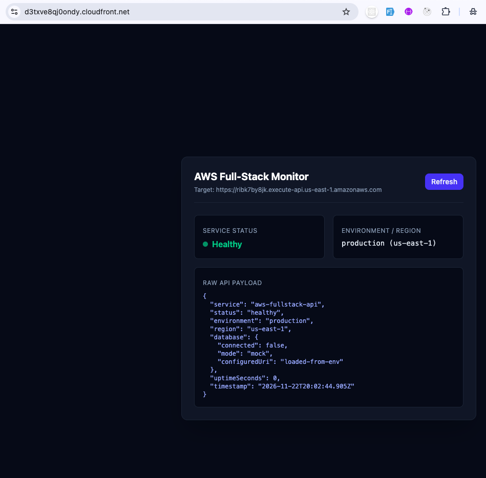
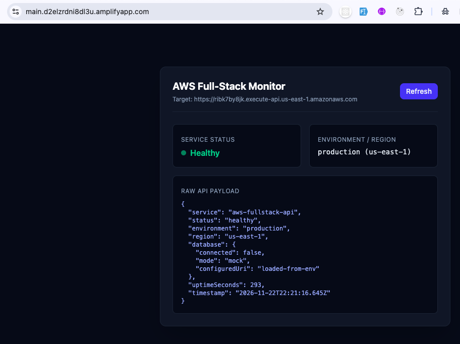
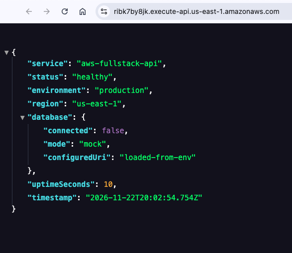

Building on the container fundamentals from `Capstone 01`, **Serverless Full-Stack** (`Capstone 02`) shifts away from managing a single virtual server toward cloud-native serverless primitives on **AWS**—eliminating idle server overhead while practicing granular IAM security, edge routing, and dual frontend delivery workflows.

### System Overview

Instead of provisioning an EC2 instance or long-running Node process, every layer scales to zero when idle and communicates securely over HTTPS:

* **Serverless Express Compute:** Wrapped an ES Module **Express.js** REST API with `serverless-http` inside **AWS Lambda**, allowing familiar Express routing and environment variables to run inside ephemeral microVMs.
* **HTTP API Gateway Routing:** Exposed the Lambda function publicly using **Amazon API Gateway (HTTP API)** with a `$default` stage and catch-all `/{proxy+}` routing so any Express endpoint resolves cleanly without extra path prefixes.
* **Dual Frontend Hosting (Manual Edge vs. Managed CI/CD):** Deployed the **React (Vite)** static UI using two complementary AWS patterns:
  1. **Private S3 + CloudFront + Edge Function:** Locked down an S3 origin with **Origin Access Control (OAC)** and wrote a **CloudFront JavaScript Function** (`rewrite-index`) to handle SPA root routing cleanly.
  2. **AWS Amplify Hosting:** Connected the GitHub monorepo (`ui/` root directory) to **Amplify** for automated Git-driven builds, SSL provisioning, and environment variable injection.

### How I Shipped It (Security, Edge & CI/CD)

Taking a decoupled app from `localhost` to production AWS infrastructure required wiring up least-privilege permissions, edge rewrites, and cross-origin controls:

#### 1. Least-Privilege IAM & Lambda Packaging
* Created a dedicated IAM execution role (`aws-fullstack-lambda-role`) scoped strictly to `AWSLambdaBasicExecutionRole` for CloudWatch logging.
* Bundled the Express entry file and `node_modules` into a lightweight `api.zip` artifact, configured runtime environment variables (`ENVIRONMENT`, `APP_REGION`, `MONGO_URI`), and verified a `200 OK` health payload using an API Gateway proxy test event.

#### 2. API Gateway Proxy & Catch-All Routes
* Wired an **HTTP API** integration (`v2.0`) to the Lambda function with `ANY /` and `ANY /{proxy+}` routes on an auto-deployed `$default` stage, verifying live JSON responses directly over the AWS-managed HTTPS invoke URL.

#### 3. Private S3 Storage, CloudFront OAC & Edge Function
* Built the production React bundle (`npm run build`) with `VITE_API_URL` pointing to API Gateway and uploaded the assets to a **private S3 bucket** with all public access blocked.
* Placed **Amazon CloudFront** in front of S3 using **Origin Access Control (OAC)** and an explicit S3 bucket policy (`s3:GetObject` restricted to the distribution ARN).
* Published a **CloudFront Function** (`rewrite-index`) on `Viewer request` events so root `/` requests automatically resolve to `/index.html` instead of triggering an S3 `AccessDenied` list error.

#### 4. Managed CI/CD Comparison with AWS Amplify
* Connected the monorepo's `ui` root directory to **AWS Amplify Hosting**, injected `VITE_API_URL` at build time, and verified automatic HTTPS builds on every push to `main`—seeing firsthand how Amplify abstracts S3, CloudFront, and SPA routing under the hood.

#### 5. End-to-End CORS Synchronization & FinOps Teardown
* Synchronized allowed frontend domains (`*.cloudfront.net` and `*.amplifyapp.com`) across both **API Gateway CORS** preflight rules and Lambda's `ALLOWED_ORIGINS` environment variable so browser requests succeeded without wildcard `*` origins.
* Once verified end-to-end, executed a reverse-dependency **FinOps teardown** (Amplify → CloudFront + Edge Function + OAC → S3 → API Gateway → Lambda + CloudWatch Logs → IAM Role) to return monthly cloud spend to **$0.00**.

### Key Takeaways & What's Next

Deploying the same React frontend via both **manual S3/CloudFront wiring** and **AWS Amplify** clarified how managed PaaS tools abstract underlying cloud primitives:

* **Learning XP:** Debugging S3 `AccessDenied` responses on root paths, configuring Origin Access Control policies, and aligning CORS headers across API Gateway and Express reinforced how cloud security and browser security interact in production.
<!-- * **Looking Ahead to Capstone 03:** Next, I will extend this serverless architecture with live cloud database persistence (MongoDB Atlas / DynamoDB), automated GitHub Actions test gates, and Infrastructure as Code (Terraform / AWS SAM) so the entire stack can be spun up and torn down with a single command. -->
