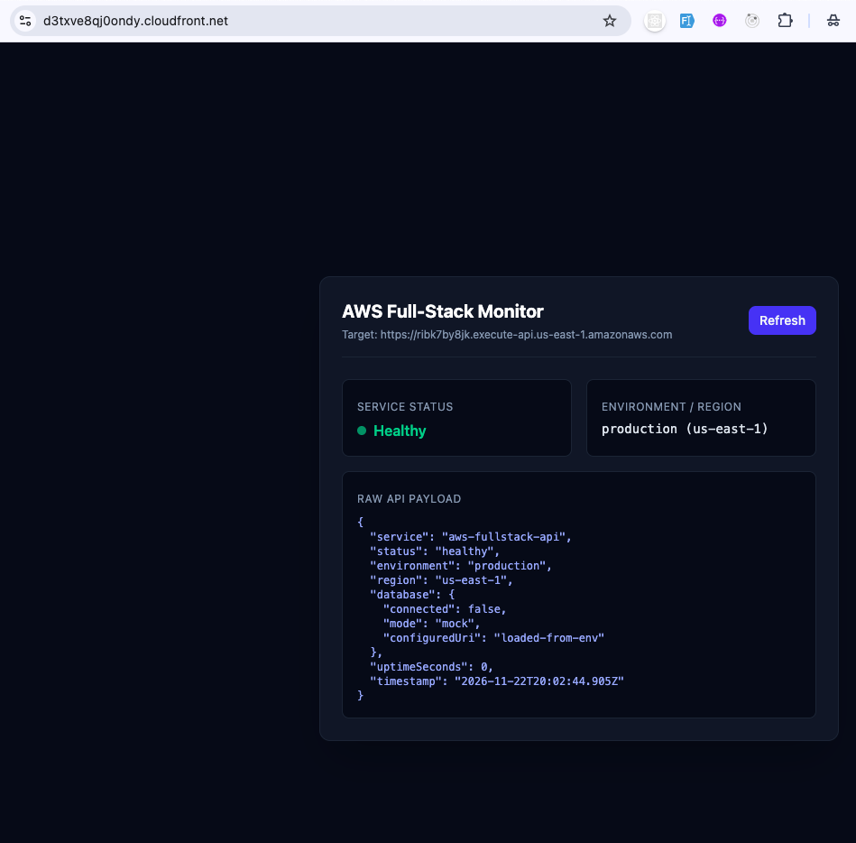
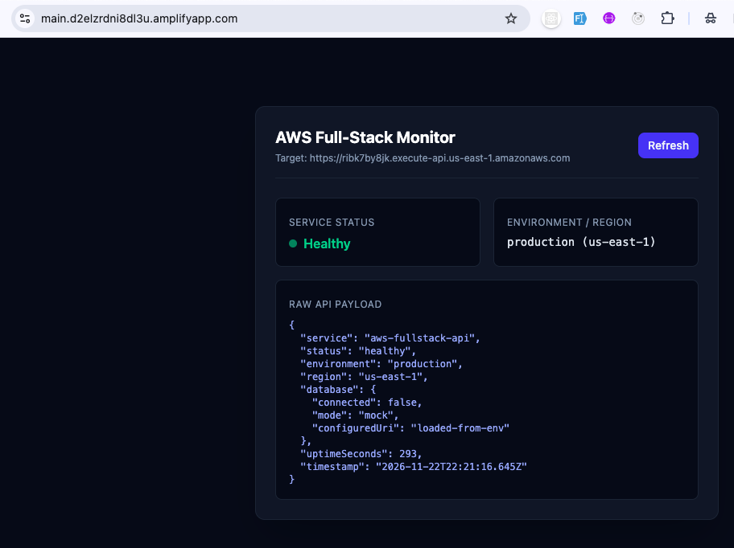
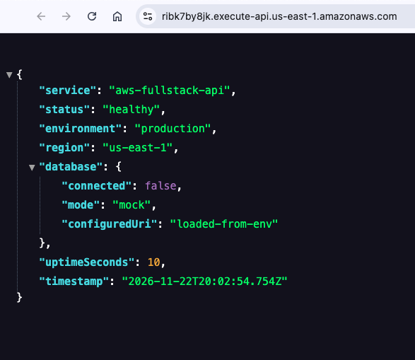

`Capstone 01` बाट सिकेका कन्टेनरका आधारभूत अवधारणाहरूलाई अगाडि बढाउँदै, **Serverless Full-Stack** (`Capstone 02`) ले एउटै भर्चुअल सर्भर व्यवस्थापन गर्नुको सट्टा **AWS** का क्लाउड-नेटिभ Serverless प्रविधिहरूतर्फ ध्यान केन्द्रित गर्छ। यसले निष्क्रिय सर्भरको खर्च घटाउनुका साथै सूक्ष्म IAM सुरक्षा, एज राउटिङ (Edge Routing), र दोहोरो फ्रन्टएन्ड डेलिभरी प्रक्रियाको व्यावहारिक अभ्यास गराउँछ।

### प्रणालीको रूपरेखा (System Overview)

EC2 इन्स्ट्यान्स वा निरन्तर चलिरहने Node प्रोसेस चलाउनुको सट्टा, यस प्रणालीका प्रत्येक तह प्रयोग नभएको बेला शून्य (Scale to Zero) मा झर्छन् र HTTPS मार्फत सुरक्षित रूपमा सञ्चार गर्छन्:

* **Serverless Express Compute:** ES Module मा आधारित **Express.js** REST API लाई `serverless-http` प्रयोग गरी **AWS Lambda** भित्र राखिएको छ, जसले परिचित Express राउटिङ र इन्भाइरोन्मेन्ट भेरिएबलहरूलाई क्षणिक microVM भित्र चल्न सक्षम बनाउँछ।
* **HTTP API Gateway Routing:** **Amazon API Gateway (HTTP API)** मा `$default` स्टेज र catch-all `/{proxy+}` राउटिङ प्रयोग गरी Lambda फंक्सनलाई सार्वजनिक रूपमा उपलब्ध गराइएको छ, जसले अतिरिक्त पाथ प्रिफिक्स बिना नै जुनसुकै Express एन्डपोइन्टलाई सहज रूपमा चलाउँछ।
* **दोहोरो फ्रन्टएन्ड होस्टिङ (Manual Edge vs. Managed CI/CD):** **React (Vite)** स्ट्याटिक UI लाई दुईवटा पूरक AWS पद्धतिहरूबाट डिप्लोय गरिएको छ:
  1. **Private S3 + CloudFront + Edge Function:** **Origin Access Control (OAC)** प्रयोग गरी S3 ओरिजिनलाई सुरक्षित राखिएको छ र SPA रूट राउटिङ मिलाउन **CloudFront JavaScript Function** (`rewrite-index`) लेखिएको छ।
  2. **AWS Amplify Hosting:** GitHub मोनोरिपो (`ui/` रूट डाइरेक्टरी) लाई **Amplify** सँग जोडेर स्वचालित Git-आधारित बिल्ड, SSL प्रमाणपत्र, र इन्भाइरोन्मेन्ट भेरिएबल इन्जेक्सन लागू गरिएको छ।

### मैले यसलाई कसरी डिप्लोय गरें (Security, Edge & CI/CD)

Decoupled एपलाई `localhost` बाट प्रोडक्सन AWS पूर्वाधारमा लैजान न्यूनतम अधिकार (Least-Privilege) अनुमति, एज रिराइट, र क्रस-ओरिजिन नियन्त्रणहरू मिलाउन आवश्यक थियो:

#### १. Least-Privilege IAM र Lambda प्याकेजिङ
* CloudWatch लगिङका लागि मात्र `AWSLambdaBasicExecutionRole` दिइएको छुट्टै IAM एक्जिक्युसन रोल (`aws-fullstack-lambda-role`) सिर्जना गरियो।
* Express इन्ट्री फाइल र `node_modules` लाई सानो `api.zip` फाइलमा प्याकेज गरी रनटाइम इन्भाइरोन्मेन्ट भेरिएबलहरू (`ENVIRONMENT`, `APP_REGION`, `MONGO_URI`) सेट गरियो, र API Gateway प्रोक्सी टेस्ट इभेन्टबाट `200 OK` हेल्थ रेस्पोन्स प्रमाणित गरियो।

#### २. API Gateway Proxy र Catch-All राउटहरू
* स्वतः डिप्लोय हुने `$default` स्टेजमा `ANY /` र `ANY /{proxy+}` राउटहरू राखी **HTTP API** इन्टिग्रेसन (`v2.0`) लाई Lambda फंक्सनसँग जोडियो, र AWS द्वारा व्यवस्थित HTTPS इन्भोक URL बाट सिधै लाइभ JSON रेस्पोन्स परीक्षण गरियो।

#### ३. Private S3 Storage, CloudFront OAC र Edge Function
* `VITE_API_URL` लाई API Gateway तर्फ फर्काएर प्रोडक्सन React बन्डल (`npm run build`) तयार पारियो र सबै सार्वजनिक पहुँच बन्द गरिएको **प्राइभेट S3 बकेट** मा अपलोड गरियो।
* **Origin Access Control (OAC)** र स्पष्ट S3 बकेट पोलिसी (वितरण ARN मा मात्र सीमित `s3:GetObject`) प्रयोग गरी S3 को अगाडि **Amazon CloudFront** राखियो।
* रूट `/` अनुरोध आउँदा S3 को `AccessDenied` त्रुटि आउनुको सट्टा स्वतः `/index.html` खुलोस् भन्नका लागि `Viewer request` इभेन्टमा **CloudFront Function** (`rewrite-index`) प्रकाशित गरियो।

#### ४. AWS Amplify सँग Managed CI/CD तुलना
* मोनोरिपोको `ui` रूट डाइरेक्टरीलाई **AWS Amplify Hosting** सँग जोडी बिल्ड समयमा `VITE_API_URL` इन्जेक्ट गरियो, र `main` ब्रान्चमा पुश गर्नासाथ स्वचालित रूपमा HTTPS बिल्ड हुने प्रक्रिया प्रमाणित गरियो—जसले Amplify ले भित्री रूपमा S3, CloudFront, र SPA राउटिङलाई कसरी सहज बनाउँछ भन्ने स्पष्ट देखायो।

#### ५. End-to-End CORS समायोजन र FinOps Teardown
* ब्राउजरका अनुरोधहरू वाइल्डकार्ड `*` ओरिजिन बिना नै सफल होऊन् भन्नका लागि अनुमति दिइएका फ्रन्टएन्ड डोमेनहरू (`*.cloudfront.net` र `*.amplifyapp.com`) लाई **API Gateway CORS** प्रिफ्लाइट नियम र Lambda को `ALLOWED_ORIGINS` इन्भाइरोन्मेन्ट भेरिएबल दुवैमा एकरूप बनाइयो।
* सम्पूर्ण प्रणालीको परीक्षण पूरा भएपछि, मासिक क्लाउड खर्चलाई पुनः **$0.00** मा राख्न उल्टो क्रममा **FinOps Teardown** (Amplify → CloudFront + Edge Function + OAC → S3 → API Gateway → Lambda + CloudWatch Logs → IAM Role) सम्पन्न गरियो।

### मुख्य सिकाइ र आगामी योजना

एउटै React फ्रन्टएन्डलाई **म्यानुअल S3/CloudFront वायरिङ** र **AWS Amplify** दुवैबाट डिप्लोय गर्दा व्यवस्थित PaaS टुलहरूले आधारभूत क्लाउड सेवाहरूलाई कसरी सरल बनाउँछन् भन्ने कुरा अझ स्पष्ट भयो:

* **सिकाइ अनुभव (Learning XP):** रूट पाथमा आउने S3 `AccessDenied` प्रतिक्रिया समाधान गर्ने, Origin Access Control पोलिसी मिलाउने, र API Gateway तथा Express बीच CORS हेडरहरू समन्वय गर्ने अभ्यासले प्रोडक्सनमा क्लाउड सुरक्षा र ब्राउजर सुरक्षाले कसरी सँगै काम गर्छन् भन्ने गहिरो बुझाइ दियो।